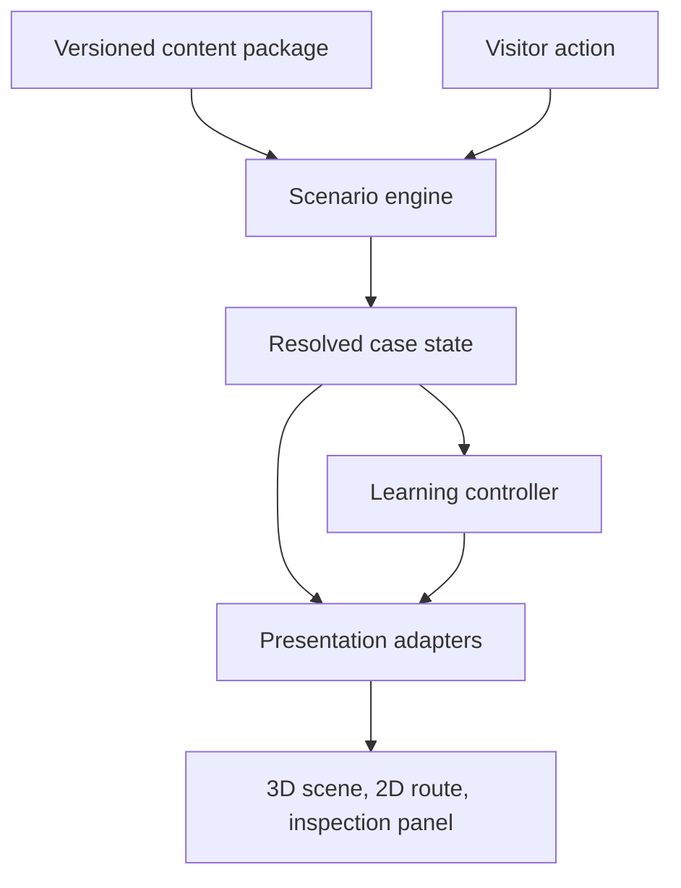

# The AI Service House — Architecture

**Status:** scenario and evidence architecture, 19 November 2026. The lesson-player presentation contract in `EXPERIENCE_REDEFINITION.md` supersedes the walking-room UI direction here. Companion to `HUMAN_SCALE_AI_ENGINEERING_PRD.md`. This document defines the product's systems and contracts before selecting a framework, rendering engine, model provider, or host.

## 1. Architectural decision

The core experience is a **deterministic, rule-driven educational simulation with authored outcomes**. A guided journey permits one controlled intervention at a time. A separate experiment mode permits combinations of interventions and explains them from the resulting state. Both modes use the same scenarios, rules, evidence, and presentation components. A live model is outside the core architecture and could be added later as an explicitly labeled laboratory.

This choice serves the teaching goal: a visitor can replay the same situation, change one cause, and compare outcomes. The simulation makes no claim that a production model will behave identically. The site must always distinguish an authored illustration from a measured or live result.

## 2. System boundaries

| System | Owns | Does not own |
|---|---|---|
| Content package | Fictional documents, passages, timestamps, roles, cases, explanatory text, rubrics, scene cues | Visitor state or UI rendering |
| Scenario engine | Valid actions, event transitions, derived outcomes, provenance, snapshots | Camera animation or DOM layout |
| Learning controller | Guided progression, prediction gates, unlocks, assessment, experiment-mode navigation | Technical truth of scenario outcomes |
| Presentation adapters | 3D human-scale scenes and equivalent 2D diagrams, captions, inspection panels | Rules, permissions, or answer determination |
| Local session store | Progress, selected view, snapshots, accessibility preferences | Canonical content or real-world personal records |
| Optional analytics | Aggregate educational interaction events with privacy limits | Core scenario correctness |

The browser can run the complete core simulation from versioned static content. No provider API, real calendar, authentication service, or personal data is required for its educational scenarios. A server may later serve content, aggregate opted-in learning metrics, or support a separate live laboratory; it must not become an implicit dependency of the guided experience.



## 3. A single source of scenario truth

The **case state** is the authoritative description of one simulated run. Scenes never infer whether a visit is possible from animation or text fragments. They receive a resolved state and render it. The engine derives claims, eligibility, action status, and explanations using authored rules and content references.

```ts
type CaseState = {
  schemaVersion: string;
  scenarioId: string;
  contentVersion: string;
  mode: "guided" | "experiment";
  runId: string;
  step: number;
  effectiveDate: string;                 // fictional ISO date
  actor: { roleId: string; permissions: string[] };
  request: { textId: string; intentId: string };
  data: { activeDocumentIds: string[]; visibilityOverrides: string[] };
  context: { instructionId: string; exampleIds: string[]; passageIds: string[]; budget: number };
  retrieval: { queryId: string; strategyId: string; candidateIds: string[]; rankedIds: string[] };
  tools: { fixtureId: string; callIds: string[]; actionStatus: "none" | "proposed" | "pending_review" | "confirmed" | "failed" | "unknown" };
  response: { outcomeId: string; claimIds: string[]; citationIds: string[]; status: string };
  evaluation: { caseIds: string[]; resultIds: string[] };
  deployment: { bundleId: string; incidentId?: string };
  interventionIds: string[];
};
```

This is a conceptual contract, not a final TypeScript API. IDs refer to canonical content. Large document text, captions, and animation assets are not duplicated into state. Internal source eligibility is evaluated before retrieval; the state may record an attempted access, but a public response cannot acquire a staff-only passage merely because a visual card moved nearby.

### State invariants

1. Every claim in an answer records either an exact supporting passage or an explicit `unsupported` status.
2. Every passage includes a source, effective interval, version, trust classification, and audience eligibility.
3. A proposed tool call cannot be rendered as a completed action.
4. A simulated write requires a valid role, permitted tool, validated arguments, and the scenario's confirmation event.
5. An ambiguous external result produces `unknown` until a status check resolves it; retries with the same operation ID cannot duplicate a write.
6. A view change, camera move, replay speed, or accessibility setting cannot alter the scenario outcome.
7. All random-looking variations use a fixed seed or authored alternatives so a shared run is reproducible.
8. An experiment state with incompatible interventions is rejected with an explanation, never silently coerced.

## 4. Events, rules, and replay

Visitor actions produce **semantic events**, not direct mutations to arbitrary state fields. Examples: `select_instruction`, `remove_context_passage`, `change_actor_role`, `set_retrieval_strategy`, `retire_document`, `inject_tool_timeout`, `request_slot_check`, `approve_proposal`, `run_eval`, `deploy_bundle`. Each event carries a typed payload, origin scene, sequence number, and scenario version.

The engine processes an event in this order:

1. Check that the event is allowed in this scenario and mode.
2. Validate its payload and preconditions against the current state.
3. Apply the deterministic transition.
4. Recompute affected downstream stages in dependency order.
5. Produce a new immutable state snapshot plus a **causal explanation** identifying changed inputs, rules, and outcomes.
6. Emit semantic presentation cues such as `document_selected` or `approval_required`; these cues do not determine truth.

```ts
type ScenarioEvent = {
  eventId: string;
  sequence: number;
  type: string;
  payload: Record<string, unknown>;
  sceneId: string;
  scenarioVersion: string;
};

type TransitionResult = {
  state: CaseState;
  explanationIds: string[];
  changedPaths: string[];
  presentationCueIds: string[];
  rejected?: { reasonId: string };
};
```

The event log and initial fixture reproduce a run. Undo rewinds to a prior snapshot and replays the retained events; it does not attempt to reverse a side effect. Since the core is a simulation, no real booking occurs. Comparison uses two immutable run snapshots with identical starting fixture and independently tracked interventions.

### Dependency graph

Data/version/role changes may affect eligible documents → retrieval candidates → selected context → supported claims → available tool actions → evaluation → operational indicators. Prompt examples change response patterns but do not grant document access. A calendar timeout changes action status and user messaging without changing the public notice. The dependency graph should be explicit so experiment mode can combine valid changes and name all material causes; it must not use a giant list of hand-authored answers for every possible combination.

## 5. Guided journey and experiment mode

**Guided mode** starts every lesson from a known snapshot. A short narrative introduces one question, asks the visitor to predict an outcome, offers one intervention, then reveals a before/after comparison and source-backed explanation. Other controls remain visible as previews but are inactive in that step. Visitors can replay, skip already completed scenes, or enter a concept space directly. Progress is stored by learning objective rather than by camera position.

**Experiment mode** unlocks after the visitor has observed the relevant concepts, though it is also accessible from a clearly marked menu for returning visitors. It offers compatible controls across rooms, displays the current intervention list, and shows a causal change report. Example: remove the current notice, enable stale caching, and change the user role. The result must identify which change removed evidence, which reused an old answer, and which changed permitted data. When causes interact, the explanation states the interaction rather than assigning a fabricated single cause.

The case folder persists between rooms. Switching modes creates a **fork** of the run so an experiment never corrupts the guided baseline. Reset returns to the scenario's canonical fixture. Shareable state, if added, should encode a scenario ID, version, and safe event sequence; it must not embed private data or untrusted executable content.

## 6. Content and authoring model

The content package is versioned and reviewed as data. Its primary entities are:

| Entity | Required fields | Purpose |
|---|---|---|
| Scenario | ID, version, fictional date, initial state, learning objectives | Defines a coherent case. |
| Document | ID, version, source, trust level, audience, effective interval, supersedes ID | Maintains provenance and eligibility. |
| Passage | ID, document ID, exact text, location, semantic tags | Grounds retrieval and claims. |
| Instruction/example | ID, role, text, intended behavior, cautions | Drives context lessons. |
| Tool fixture | ID, schema, request, response, status, operation ID | Simulates valid and failing actions. |
| Rule | ID, preconditions, transition, explanation ID, affected stages | Produces deterministic consequences. |
| Claim | ID, text, supporting passage IDs or unsupported status | Enables citation inspection. |
| Evaluation case | ID, input state, rubric, expected properties, slice tags | Checks behavior across scenarios. |
| Scene | ID, concept, objectives, controls, narration, cues, 2D equivalent | Presents a learning event. |
| Explanation | ID, plain text, technical detail, source IDs | Makes cause inspectable. |

The fictional Saturday case should be authored as a canonical source set with exact dates and passages before animation work. Content validation checks unique IDs, resolvable references, valid effective intervals, role eligibility, and claim-to-passage support. Reviewers should inspect every branch for narrative consistency and every technical statement against authoritative documentation. Platform-specific copy is isolated from the scenario and has a reviewed date, because platform features and terminology can change.

## 7. The eight spaces as one event flow

| Space | Input from case folder | Key event | Derived output passed forward |
|---|---|---|---|
| Briefing desk | Request, role, eligible context | Select instruction/example/passage | Assembled task and response contract |
| Records room | Source documents and labels | Clean, classify, version, split | Eligible and evaluable records |
| Reference library | Query and eligible passages | Search, filter, rerank | Ranked evidence and citations |
| Service counter | Intent, evidence, permissions | Call tool, handle error, review action | Tool status and proposed/completed action |
| Experience workshop | Response, services, timing | Change caching, fallback, UI state | User-facing experience and performance trace |
| Test room | Whole run and rubric | Execute evaluation case set | Scores, failures, root-cause tags |
| Security checkpoint | Role, sources, proposed actions | Probe injection/access path | Enforced allow/deny result and risk trace |
| Operations room | Bundle, traces, feedback | Roll out, detect, contain, recover | Incident record and verified version |

The spatial walk can teach concepts in this order, but the actual runtime dependency order is **data eligibility → retrieval → context assembly → model-like authored outcome → tool action → UI**, with evaluation, security checks, and operations observing and governing several stages. The 3D route may introduce the briefing desk first to start with the visitor's question; the engine must not pretend that data is created only after a prompt is assembled.

## 8. Presentation architecture

A shared **scene view model** translates resolved state into semantic display facts: visible actors, labeled objects, handoff, timeline, selected passage, call status, compare delta, narration cue, and focus target. Two renderers consume it:

- **3D renderer:** contemporary human-scale building, people in human roles, ordinary objects, spatial transitions, and restrained motion. Camera movement is presentation only. All decisive text appears in HTML panels.
- **2D renderer:** accessible diagrams, cards, tables, and timeline with the same content and controls. This is a first-class route, not a fallback screenshot of 3D.

The inspection panel is shared. It can show raw fictional passages, assembled messages, JSON-like payloads, ranked results, claim support, evaluation rubrics, and traces. Beginner view describes what happened in plain language; Engineer view exposes the underlying records and rule IDs. Neither view changes the outcome.

The renderer announces a state transition only after the engine has resolved it. If animation fails or WebGL is unavailable, the 2D route continues. Motion never blocks reading or interaction; reduced motion substitutes immediate state changes and simple fades. Keyboard focus follows logical event order rather than camera direction. Labels, captions, transcript, contrast, and screen-reader descriptions are authored alongside scene cues.

## 9. Educational correctness and truthfulness

The interface labels **fictional source**, **simulated tool result**, **authored outcome**, and **illustrative metric** where relevant. A plotted embedding view is marked as a projection; similarity does not mean truth or access permission. A valid schema does not mean a true answer. A citation link is checked against a specific claim. A security checkpoint means an application-enforced rule, not a promise that a model will ignore malicious text. Human characters depict responsibilities, not the inner cognition of an AI system.

The content review process has two passes: a technical reviewer checks mechanisms and provider-neutral distinctions; an educator checks whether the observed event actually teaches the stated objective. A contradiction in the fictional case is a release-blocking content defect. The platform comparison drawer uses official sources and may be updated independently of the canonical scenario.

## 10. Privacy, analytics, and security of the educational site

Core scenarios contain invented data and run locally. Store progress and preferences locally by default; offer reset and deletion. Do not send visitor-entered free text to a model in the core experience. If optional aggregate analytics are added, collect event names and coarse completion signals without document contents, free-text responses, or a replayable personal event log; disclose the collection and provide a choice where required. Any share link validates event payloads against the content schema and imposes size limits. Standard web protections still apply to content rendering and dependencies.

If a live-model lab is later proposed, it must have its own architecture decision: provider routing, consent and privacy terms, moderation, rate limits, budget, abuse prevention, observability, nondeterministic result labeling, and a failure path. It must never be silently substituted for a deterministic lesson.

## 11. Performance and reliability targets to validate

Targets should be measured on representative devices during prototyping. Suggested budgets: the first meaningful explanation and controls should appear without waiting for 3D assets; scene transitions should avoid long loading pauses; low-end devices should default to or offer 2D; state changes should feel immediate because rules run locally. Large scene assets should load by room, while case text and the 2D route remain available. A failed asset load must not lose the visitor's case state. We will set numeric budgets after a prototype establishes device and audience constraints.

## 12. Verification plan

| Level | Check |
|---|---|
| Content validation | IDs, references, source dates, access roles, claim support, captions, and 2D equivalents are complete. |
| Engine invariants | Same fixture + events produce the same state; prohibited actions reject; `unknown` tool outcomes remain unknown; snapshots replay. |
| Causal scenarios | Removing a notice changes evidence; staff role changes eligible data; stale cache changes displayed answer; a retry does not duplicate a booking. |
| Learning review | Visitors can predict changes and explain which system layer caused a failure. |
| Accessibility | Keyboard and screen reader reach every action and result; reduced motion and 2D route teach the same objectives. |
| Visual review | Animations reflect state and never imply a completed action or authorization that the engine did not establish. |
| Cross-room consistency | The same document version, role, and tool status mean the same thing in all eight spaces. |

## 13. Deferred implementation decisions

The architecture intentionally leaves rendering framework, 3D engine, animation library, hosting, storage mechanism, and analytics provider open. They should be selected after exact scene scripts and an interaction prototype establish asset complexity, device support, accessibility behavior, and measured performance. The first implementation milestone is a **vertical slice** of the Saturday request across briefing, library, and service counter, with 3D/2D parity and a replayable event log. That slice tests the architecture before all rooms are produced.

## 14. Decision record

| Decision | Rationale | Revisit when |
|---|---|---|
| Deterministic rule-driven core | Repeatable causal lessons and reliable comparison | A distinct live-model lab is scoped. |
| Controlled guided changes | Clear attribution for first-time learners | User testing shows a better teaching sequence. |
| Separate experiment fork | Free combinations without corrupting guided progress | Combined-state rules become too complex to explain. |
| One state, two presentation adapters | 3D and accessible 2D show the same facts | A renderer-specific behavior is proven educationally necessary. |
| Fictional service center | Covers all eight concepts without real sensitive data | A better unifying case passes the same coverage review. |
| Provider-neutral scenario | Durable concepts despite platform changes | A platform-specific lesson is explicitly added. |

**Next design artifact:** exact scenario fixtures and scene scripts for one vertical slice. Before implementation, those scripts should specify every visitor control, rule transition, evidence panel, line of narration, 3D human action, and 2D equivalent.
