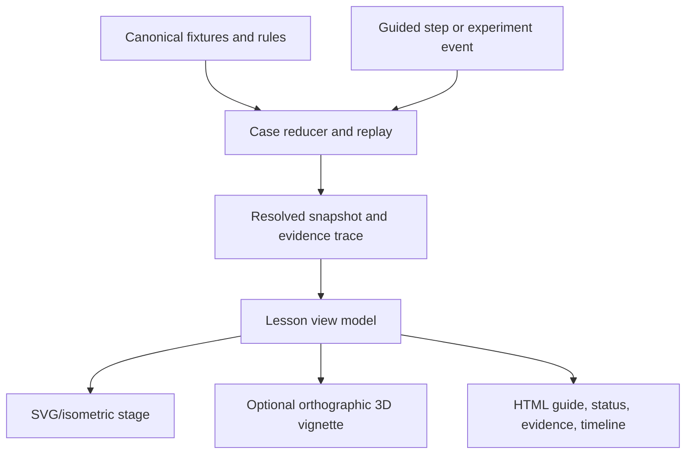

# The AI Service House — Experience Redefinition

**Design decision · 19 November 2026.** This document supersedes the *presentation and lesson-flow* directions in the earlier PRD, architecture, tech-stack, and phase plan. Their canonical Riverside case, source passages, permissions, deterministic rules, and educational distinctions remain in force. This is the next product contract, not a claim that the redesigned frontend is already implemented.

## 1. Reference inspection and correction

The requested reference is [Designed to Scale](https://designed-to-scale.vercel.app/). I inspected its live first lesson, its caching lesson at the stale-cache step, and the supplied 101.8-second video at seven points across scaling, load balancing, storage, sharding, authentication, and deployment. The video is a screen recording of the reference's visual language. The browser observations, rather than a claim about its source code, support this comparison.

| Observed quality | Reference behavior | Current Service House | Decision |
|---|---|---|---|
| Primary stage | An isometric system diagram occupies most of the center; actors and links are labeled. | A comparatively short 3D panel sits above a long document page. | Make the animated case stage the main teaching surface. |
| Lesson progression | A numbered step changes scene, status counters, explanation, and timeline together. Direct step selection and Back/Next work. | Each first room has one prediction/reveal action; five further rooms have one core action or recovery trace. | Author 4–6 coherent core beats per space, each with a visible event and causal explanation. |
| Guide | A narrow adjacent panel names the current problem/technique, tells a short story, highlights a key idea, and says what changed. | Important text appears in several vertically separated sections. | Keep one focused guide beside the stage; open evidence in an inspectable drawer. |
| Visual grammar | Physical-looking isometric objects, people/icons, paths, moving markers, labels, and small live readouts. | Blender room vignette emphasizes place; it does not spatially trace all causal handoffs. | Use a human-scale service workflow diagram with real-world desks and staff roles plus explicit evidence paths. |
| Playback | Replay/pause and a visible step timeline; movement settles into a readable state. | Clip controls exist, but the scene is not the lesson's central timeline. | One lesson clock coordinates motion, guide, metrics, captions, and step URL. |
| Scope | Searchable course navigation and progress. “Practice” and “Design Lab” showed coming-soon notices during inspection. | Eight links and nested optional cards, with separate three-room and five-room templates. | Build honest navigation and progress from completed learning checks; do not imitate inactive modes. |
| Failure teaching | The caching step shows a changed database value, an old cache value, users seeing the stale value, and a corresponding status change. | Text explains the stale cache, while the five-room study has no comparable central diagram. | Every failure must show at least two conflicting artifacts and the route by which the wrong one reached the visitor. |

**Important distinction:** the reference looks spatial and animated. Its appearance alone does not establish that it uses a 3D engine or WebGL. The Service House can use an orthographic 3D scene for human vignettes and an SVG/isometric diagram for the always-readable causal path. We will not copy its particular illustrations, text, icon set, layout proportions, or branding.

## 2. Revised product thesis

**Follow one public service question through the entire AI service, one observable handoff at a time.** The visitor sees the Riverside Community Services Center as a clear, human-scale system: visitor, clerk, records worker, librarian, service worker, reviewer, security officer, and operator occupy ordinary workstations. Paper cards, shelf records, trays, forms, a calendar terminal, and version tags carry the case across spaces. A moving card represents an information transfer; its label and adjacent evidence state what actually transferred. People depict human roles and responsibilities. The model has no human avatar.

The central question remains **“Can I come this Saturday to get help with my application?”** Saturday 21 November 2026 reception is open 09:00–12:00 for general information; application-help appointments are suspended. Tuesday 24 November slot results are simulated; a proposal is never a booking. The old notice is superseded. The staff rota is never shipped to a public browser. These facts are the invariant spine of the whole experience.

The first guided pass targets **26–30 minutes as an unmeasured design hypothesis**: about 40 short steps across eight spaces, a four-minute diagnostic, and brief orientation/transitions. A visitor may pause or choose a space. Optional inspection is unbounded and is not required to complete the first pass. A pilot will decide whether the step count or duration needs adjustment.

## 3. The new screen contract

Desktop lesson view is a three-part composition with a persistent timeline:

| Area | Role | Content that must remain legible |
|---|---|---|
| Left course rail | Find eight spaces and resume progress. | Space title, core-step progress, current location; nested optional topics on demand. |
| Central stage | Watch the causal event. | Human-scale stations, labeled documents, directed handoffs, eligibility/permission gates, evidence links, action state; no paragraph-sized text baked into 3D. |
| Right guide | Explain exactly this beat. | Step label (problem, mechanism, failure, repair, or check), two short paragraphs at most, key idea, *what changed*, Back/Next. |
| Stage header | Read current, authored state. | Three to five status chips selected per concept: e.g. notice version, candidate count, claim support, tool status, booking status. Never label invented values as measured production metrics. |
| Bottom timeline | Control the lesson. | Numbered beat names, visited/completed state, replay, pause/play, previous/next, direct selection, and keyboard shortcuts with visible help. |
| Evidence drawer | Verify the claim. | Exact public passage, source/version/effective date, candidate list, request/response, case trace, rubric, compare snapshots, Engineer view; secure source bodies excluded. |

On a narrow screen, the stage precedes the guide and timeline in reading order. The rail becomes a compact lesson picker. The current step's explanation and status remain visible without horizontal scrolling. All controls are HTML. The stage is illustrative; no learning objective relies on a canvas-only gesture or a tiny label.

### Concrete screen: briefing, step 4

The stage shows three separate places: the **current public notice** on the records shelf, the **selected context tray**, and the **answer form**. A labeled path runs shelf → tray → answer. The visitor selects **Remove notice from this answer's context** in the guide. The path from shelf to tray breaks and the notice card leaves the tray; the card stays on the shelf. The status strip changes from `Notice in context: yes` and `Saturday sessions: suspended (supported)` to `Notice in context: no` and `Saturday sessions: unverified from this context`. The booking chip remains `not_booked` throughout.

The guide says: “The record still exists. This answer did not receive its decisive passage. Reception hours cannot establish application-help availability.” Its *what changed* rows name `context: −p-notice-1` and `claim support: suspended → unverified`. The evidence drawer opens the exact v2 notice and marks it **public, current, effective, not selected**. Back restores the reference snapshot; replay repeats only the card motion; skip jumps to the same resolved final state. Reduced motion displays the broken path and final labels immediately. This is the quality bar for every later step.

### Visual and motion language

- Use warm civic materials, ordinary furniture, stationery, and recognizable staff silhouettes. A slightly elevated orthographic/isometric view makes transfers visible without forcing a walking camera.
- Give each *role* a consistent appearance and location. A human hand can place a card, but the animated card's provenance, ID, and destination do the teaching.
- Color and shape encode **public/current**, **superseded**, **candidate**, **selected context**, **supported**, **unverified**, **denied**, **proposed**, and **not booked**. Pair every color with a text label and legend.
- Paths are directional and local to the active step. A marker travels only after the underlying state transition is resolved. The previous and next artifacts remain visible long enough to compare.
- Camera framing changes between *spaces*, not during every explanation. Avoid auto-orbit, hidden text on object surfaces, and gestural success that contradicts a failed tool response.
- The scene has a deliberate hold frame at each step; replay repeats the cue, and pause/scrub/skip affect only presentation time. Reduced motion shows the final labeled state immediately.

## 4. Eight-space guided storyboard

Each row is a **core beat contract**, not a claim that the present frontend implements it. Every beat gets a stable URL, pre-state, one semantic event or authored inspection, post-state, scene cue, status change, explanation, exact evidence link, transcript, and a learning check. Optional subtopics remain in `PHASE_5_INSPECTION_MATRIX.md` and will become steps only after this core path is validated.

| Space | Five core beats in order | Stage grammar and decisive learner action |
|---|---|---|
| Briefing desk | 1. Receive ambiguous request; 2. separate task brief from source text; 3. assemble the public context; 4. remove current notice; 5. compare supported and unverified answer. | Clerk receives a question card. A bounded tray shows selected passages. Learner removes `p-notice-1`; the passage leaves the tray but stays in records. Status changes to `unverified`; evidence drawer shows why. |
| Records room | 1. inspect origin/audience; 2. compare v1 and v2 effective dates; 3. spot duplicated/contaminated examples; 4. activate current notice; 5. apply public-eligibility gate. | Archivist stamps v1 *superseded* and shelves v2. Learner selects the eligible dated version; a staff-only folder stays closed. Show provenance and coverage separately from volume. |
| Reference library | 1. parse scoped passage; 2. run current search; 3. narrow to hours; 4. try reranking; 5. send selected evidence to briefing. | Librarian traces a search from query to candidate cards. Learner narrows retrieval; `p-notice-1` never enters the list. Reranking reorders only what is present. |
| Service counter | 1. validate typed lookup; 2. read Tuesday slot fixture; 3. propose one time; 4. encounter timeout; 5. distinguish proposal from confirmation. | Worker checks a terminal. A slot card moves to *proposed*, never *booked*. On timeout, fresh availability is unknown and the proposal clears. No simulated booking write is introduced. |
| Experience workshop | 1. trace request/response contract; 2. observe latency components; 3. serve current answer; 4. serve stale v1 cache after notice update; 5. invalidate dependent cache. | A kiosk, app desk, source shelf, and cache tray show two versions simultaneously. Learner invalidates the stale entry; the visitor-facing answer follows current source evidence. Timing values are clearly illustrative. |
| Test room | 1. define rubric; 2. inspect five fixed cases; 3. run baseline 3/5; 4. run candidate 4/5; 5. hold release for critical Saturday regression. | Reviewers place five cards into pass/fail rows. Aggregate rises while the dated critical case flips pass→fail. Learner identifies the blocking case and its trace. |
| Security checkpoint | 1. label external page lower trust; 2. observe hostile rota instruction; 3. check public role; 4. deny staff read; 5. inspect safe audit result. | Guarded cabinet remains shut. Learner attempts the request; a denied route, role, and reason appear, without rota body or secret-like content. The application gate, not a reassuring prompt, enforces it. |
| Operations room | 1. compare source and index versions; 2. deploy stale index; 3. see missing candidate and alert; 4. contain, restore index, invalidate cache, roll back failed candidate; 5. verify affected Saturday slice. | Operator uses version cards and an incident board. Learner steps through the exact recovery trace. Deployment completion alone is insufficient; verification requires candidate, displayed answer, and critical case to agree. |

The **final diagnosis** reuses a frozen snapshot: the current notice says suspended, the deployed index omits it, the cache displays the older plan, and no booking confirmation exists. The visitor traces the wrong answer through source → index → candidate → context → cache/display and chooses repairs. The existing nine-point rubric remains the scoring source. Scoring explains omissions by layer rather than revealing a single undifferentiated answer.

## 5. Interaction and state architecture

Retain the pure scenario reducers and canonical public fixture. Introduce a **lesson script** between scenario state and presentation. A step is a selection of a known snapshot and permitted intervention, not a separate source of truth. The first three-room state and the five extended-room state currently use different sessions; consolidate them into one versioned case log with named forks before migrating the new frontend. Older local saves must migrate or reset with an explicit message.



Proposed authoring contract:

```ts
type LessonBeat = {
  id: string;
  spaceId: SpaceId;
  title: string;
  kind: 'problem' | 'mechanism' | 'failure' | 'repair' | 'check';
  referenceSnapshotId: string;
  allowedEvent?: ScenarioEvent;
  scene: { nodes: string[]; paths: string[]; cueIds: string[]; focusId: string };
  statusFields: StatusFieldId[];
  guide: { explanation: string; keyIdea: string; changed: string[] };
  evidenceIds: string[];
  transcript: string;
  checkId?: string;
};
```

`ScenarioEvent` resolves first. The stage receives only `LessonViewModel`, a read-only projection of the resolved snapshot and cue. Animation completion can never set `retrieved`, `supported`, `authorized`, or `booked`. Direct step selection reconstructs the exact snapshot from the event log or a validated authored fixture; it never fast-forwards a clip to manufacture facts. A controlled experiment forks from a known snapshot and rejects combinations without a validated rule.

### Rendering choice

**Recommendation:** use semantic HTML plus a scalable SVG isometric stage as the universal causal renderer. SVG provides sharp geometry, explicit paths, and deterministic step states without WebGL; an equivalent HTML description and controls provide the accessible path. Keep Blender/GLB and R3F for a restrained orthographic human-scale vignette or selected room actions when it clarifies responsibility; share the same view model. Do not force all lesson state into character animation. A visual reference that appears three-dimensional does not require literal 3D for every node. The current three GLBs are prototypes to reuse selectively, not the new page layout.

This is a revised recommendation, not a statement about how the reference site was implemented. Measure the SVG and 3D options on agreed devices before setting asset and frame-time budgets. Avoid a large 3D download as a prerequisite for the first readable lesson.

## 6. Learning, accessibility, and content rules

- Core route: observe → predict when causally useful → advance one beat → inspect changed artifact and status → explain. The guide's *what changed* lines must match the reducer's trace, including multiple active causes.
- Give each space a short recap and one discriminating check. Progress means the learner has visited and answered the check; mere animation playback does not mark understanding.
- Keep public text, source citations, status labels, captions, and the complete step transcript in the DOM. Motion is optional and user-controllable. Keyboard arrows change lesson steps only when focus is not in a form field; `R` replays and Space pauses only when these shortcuts cannot hijack other controls.
- `prefers-reduced-motion` and an explicit setting suppress spatial movement and present the same final labeled state. Pause/skip/replay are always visible. The 2D stage and evidence remain complete if WebGL or an asset fails.
- Narration is optional, off by default, and never the sole carrier of information. If produced, its spoken text matches a transcript and is timed to the same semantic beat.
- Label *fictional source*, *authored simulation*, *illustrative metric*, and *simulated tool response* at the point of use. Never present a toy latency or score as measured model/platform performance.
- Human figures represent visitors and staff roles. Paths, documents, status, and evidence represent the AI service. The experience must never imply that a human avatar is the model.

## 7. Migration and acceptance plan

The existing repository is an **evidence and rule prototype**, not the target frontend. Keep its validated passages, restrictions, event replay, tests, GLB masters, and authored five-room fixtures. Replace the long-scroll templates and scattered controls in staged increments:

1. Build a **briefing lesson-player prototype** with a central isometric scene, five authored beats, adjacent guide, status chips, timeline, and evidence drawer. Make it work entirely in HTML/SVG first; apply the same state to optional 3D props.
2. Conduct a short observed comprehension review on modest phone and laptop, including keyboard and screen-reader use. Ask learners why the notice still exists but the answer is unverified. Revise labels and timing before cloning the shell.
3. Migrate library and counter into the same beat contract, preserving the exact acceptance fixtures, proposal boundary, experiment fork, and 2D/3D parity.
4. Convert the five authored studies to five-beat scripts. Replace their one-click summaries with diagram states and specific interventions. Keep optional cards scoped to their space, rather than a long undifferentiated drawer.
5. Add the final diagnosis, honest progress, search, and dated provider drawer; run cross-space event and content validation. Measure asset delivery and scene response on actual devices.

| Acceptance question | Observable pass condition |
|---|---|
| Does the first frame teach? | Visitor can identify the question, current stage, and next action without opening a drawer. |
| Does motion explain a cause? | After the notice is removed, visitor can point to the missing *context* path while the record remains on the source shelf. |
| Do guide and scene agree? | Every status chip and *what changed* line derives from the same resolved snapshot; replay/pause/skip never change facts. |
| Does failure remain truthful? | Missing candidate cannot appear after reranking; staff-only body is absent; timeout clears fresh availability; proposal remains `not_booked`. |
| Is the path accessible? | The same step, evidence, result, and controls work with keyboard, screen reader, reduced motion, and no WebGL. |
| Is the layout usable? | Modest phone and laptop review measures readability, load time, frame time, and comprehension; reviewers set thresholds before observing results. |
| Does it cover the eight distinctions? | Each core space has a step-level intervention, evidence, changed status, causal explanation, and check; the final diagnosis requires linking failures across layers. |

**Decision:** stop expanding bespoke room art or polishing the present long-scroll interface. The next implementation increment is the one-room lesson player, using the validated Saturday rules. Its result is the gate for adopting the new layout across all eight spaces.

## Research notes

The inspected reference supplied the interaction and visual pattern, not a technology mandate. [MDN's SVG documentation](https://developer.mozilla.org/en-US/docs/Web/SVG) describes scalable, localizable vector graphics; [R3F Canvas documentation](https://r3f.docs.pmnd.rs/api/canvas) supports an orthographic camera for selective 3D scenes. [W3C's animation-from-interactions guidance](https://www.w3.org/WAI/WCAG22/Understanding/animation-from-interactions) and its [JavaScript reduced-motion technique](https://www.w3.org/WAI/WCAG22/Techniques/client-side-script/SCR40) inform the motion controls. These sources support capabilities, not a claim that the reference uses these tools or that the redesigned site already passes accessibility testing.
