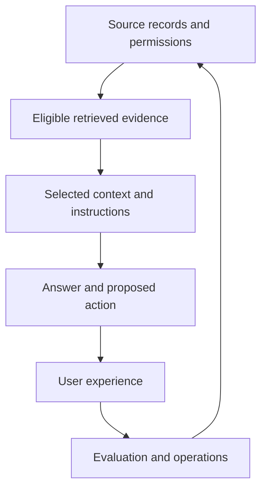

# The AI Service House — One-Page Learning Objectives

**Phase 0 baseline · 19 November 2026.** The guided walk targets 24 minutes, subject to learner testing. It teaches causal reasoning about a fictional AI-assisted community service, not vendor-specific operation.

## Transfer goal

Given an unfamiliar AI service and a questionable answer, a learner should ask **what entered the system, which evidence was eligible and found, which action actually completed, what was tested, and what changed in production**. They should locate a plausible failure layer and name evidence that would confirm or refute it.

| Concept space | After the core beat, the learner can… | Core visitor action | Evidence of understanding |
|---|---|---|---|
| Briefing desk | Distinguish instruction, selected context, and source evidence. | Remove the current notice from context. | Predict “Saturday appointment status unverified from supplied context,” while recognizing the record still exists. |
| Records room | Explain how data coverage, provenance, and time affect a result. | Replace an outdated schedule record with its current version. | Explain why volume of old pages cannot establish the current schedule. |
| Reference library | Distinguish an eligible source, retrieved candidate, and supported claim. | Use a narrow search that misses the notice, then inspect reranking. | State that reranking cannot recover a missing candidate and identify the decisive passage. |
| Service counter | Distinguish lookup, proposal, approval, and completed action. | Check Tuesday slots, then inject a timeout. | Say that neither a returned slot nor a proposed slot is a booking. |
| Experience workshop | Explain how a product can present a fast but stale answer. | Turn on a cache, then update the schedule notice. | Identify the stale answer and the freshness condition needed to invalidate it. |
| Test room | Judge a change using a representative set and specific criteria. | Run a candidate version across normal and Saturday cases. | Find a critical Saturday regression hidden by an improved aggregate score. |
| Security checkpoint | Distinguish source instructions from authorized actions and data access. | Insert a hostile line in a public page and replay a public-role request. | Identify the lower-trust entry point and the application permission check that blocks staff-only data. |
| Operations room | Trace a live quality problem to a versioned cause and verify recovery. | Investigate a spike in wrong Saturday answers. | Find the missing current notice in an index bundle, contain impact, and verify the affected slice after repair. |

## Concept map

Security checks apply at source access, tool execution, output handling, and storage; they are not a final filter that can repair every earlier error. Evaluation examines the whole path and feeds operational improvements. The spatial visitor route starts at the briefing desk for narrative clarity, while the runtime dependency begins with source eligibility.

## Assessment

The final challenge uses an incorrect “You can book Saturday” answer. The learner must select the source version, retrieved candidates, context, tool status, and deployed index version that explain it. A strong response names the cause, points to the missing/current passage, distinguishes reception hours from application-help appointments, and proposes a check after the fix. Multiple choice and a brief explanation are both available. The initial question and delayed final challenge use changed wording so success is not merely memorizing one sentence.

## Design basis

Prediction before reveal, actionable explanation afterward, and transfer to a changed case are design applications of evidence on retrieval practice and feedback. Multiple representations and ways to interact accommodate learner variability. These sources support the design principles; they do not prove that this particular 3D experience will improve learning until tested. [CAST UDL 3.0](https://udlguidelines.cast.org/) · [National Academies, *How People Learn II*](https://nap.nationalacademies.org/catalog/24783/how-people-learn-ii-learners-contexts-and-cultures) · [Education Endowment Foundation on feedback](https://educationendowmentfoundation.org.uk/education-evidence/teaching-learning-toolkit/Feedback)
