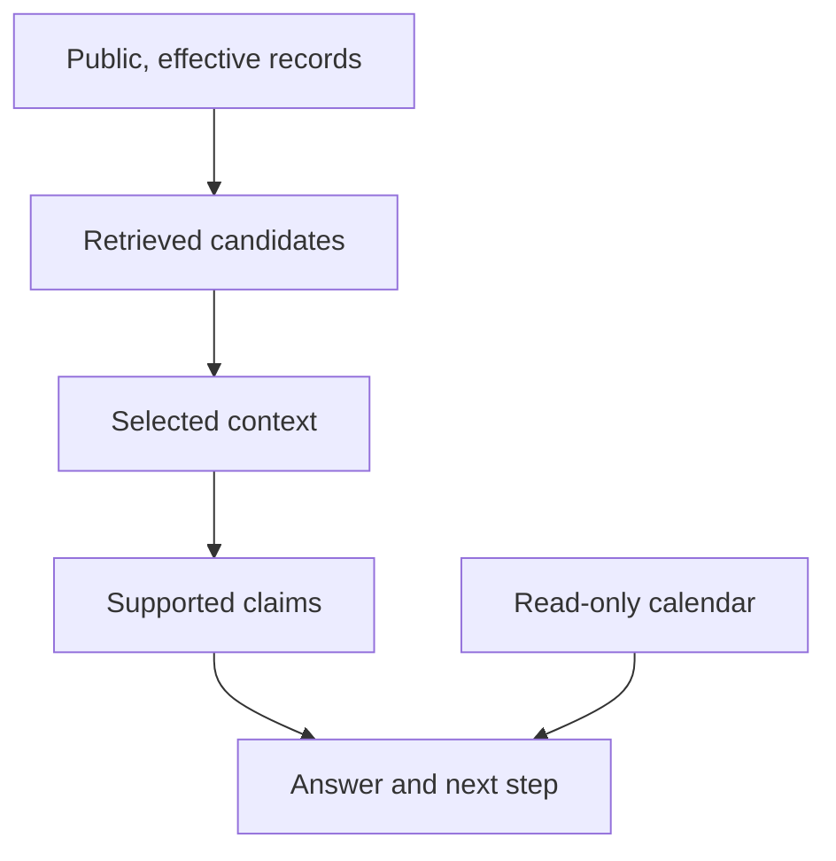

# Phase 0–2 traceability and review decisions

**Reviewed:** 19 November 2026 against the PRD, architecture, glossary, learning objectives, Saturday scene specification, and delivery phases. This record distinguishes a designed eight-space product from the implemented three-space prototype.

## Product decisions carried into the prototype

| Phase 0 decision | Phase 1 truth | Phase 2 learner view | Limit |
|---|---|---|---|
| Fictional contemporary service center, human-scale roles | Dated Riverside documents and public role | Ordinary desk/library/counter framing in 2D; no literal AI character | Human 3D figures await Phase 3. |
| Ambiguous Saturday question | Reception and appointment claims are separate | Persistent question, resolved date, case folder, different answer states | Observe whether beginners still confuse walk-in information with an appointment. |
| One causal change per guided beat | Guided session API enforces one intervention; counter has a fixed lookup and proposal reference | Prediction → reveal → process → before/after → evidence → learning check | Experiment fork deliberately permits bounded combinations. |
| Evidence and process, not model personification | Eligibility → candidates → context → claims → tool result | Stage list, candidate order, exact passages, instruction/response contract, tool request | The candidate order is authored; it is not a computed embedding score. |
| Public role and fictional data | Staff/external documents excluded by eligibility | Public-only browser content and restricted-asset scan | The repository retains fictional internal fixtures for tests; no real private data. |
| Accessible 2D parity | Pure state and semantic events independent of rendering | Semantic HTML, native controls, status announcement, skip link, reduced motion, replay | Manual screen-reader, mobile, and rendered-browser review remain open. |
| 24-minute guided eight-space target | No duration in the engine | Three-room vertical slice with no timer | Measure the full journey only after all eight core beats exist. |

## Concept coverage at this gate

| Concept | Core action in complete product | Status through Phase 2 |
|---|---|---|
| Instructions and context | Remove current notice from selected context. | Implemented, inspectable, and tested. Task brief and output fields are visible. |
| Data and provenance | Replace a dated source and inspect quality. | Source versions, dates, and eligibility fixtures exist; records-room interaction is later. |
| Retrieval and knowledge | Narrow search and inspect the missing notice. | Implemented, inspectable, and tested. Candidate order is explicitly authored. |
| Tools and agency | Lookup, propose, then see timeout without booking. | Implemented, inspectable, and tested. No write event exists. |
| Application engineering | Stale cache after a notice change. | Designed in PRD and Phase 0; no cache fixture or workshop interaction yet. |
| Evaluation | Aggregate gain hides a Saturday regression. | Designed; no evaluation suite or test-room UI yet. |
| Safety and permissions | Poisoned page attempts staff access. | Internal fixture and eligibility test exist; checkpoint interaction is later. Restricted text is absent from browser assets. |
| Operations | Missing current notice in a deployed index. | Designed; no operational incident fixture or room UI yet. |

The three implemented rooms are a vertical slice to validate the learning contract and shared state. Completion of Phase 2 does not imply completion of the eight-space PRD.

## Causal model for the Saturday slice

Removing a notice from **context** changes C and D while preserving A and B. Narrowing **retrieval** changes B, C, and D. A Tuesday **timeout** changes F and the next step but leaves the Saturday suspension unchanged. A proposal never changes booking status. This distinction is the central assessment target.

## Reviewer script and recording sheet

Use three or more real learners with different device/access needs. Tell each person that the case is fictional, then observe without explaining answers in advance. Record the device, browser, input method, and any assistive technology. Do not enter actual appointment or application information.

| Task | What to observe | Finding / quote / hesitation | Revision and retest |
|---|---|---|---|
| Interpret “Can I come this Saturday?” | Do they name reception and application help separately? | To be filled after observation | To be filled |
| Briefing | Can they identify the decisive notice and explain context versus records? | To be filled | To be filled |
| Library | Can they explain why reranking cannot add an absent candidate? | To be filled | To be filled |
| Counter | Can they distinguish checked, proposed, and booked after timeout? | To be filled | To be filled |
| Navigation | Can they use skip, route change, replay, reset, and clear progress? | To be filled | To be filled |
| Access needs | Can they complete the tasks with keyboard, screen reader, reduced motion, and mobile layout? | To be filled | To be filled |

Ask one transfer question after the rooms: “A page says reception is open, but the current appointment notice is absent from the search results. What should the answer say, and which stage would you inspect first?” Do not score success from the initial prediction alone. Note the post-reveal learning check and the learner's own explanation. Revise wording or sequence, then repeat the affected task with a fresh learner. Until that happens, the Phase 2 learner exit check remains open.
