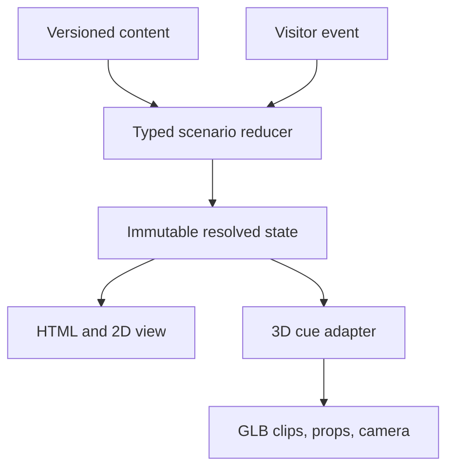

# The AI Service House — Technical Stack and 3D Production Plan

**Status:** original 3D production recommendation, 19 November 2026. `EXPERIENCE_REDEFINITION.md` now recommends an SVG/isometric causal stage with selective orthographic 3D; reassess this stack before further art production. This document supports `ARCHITECTURE.md` and `SATURDAY_VERTICAL_SLICE.md`. It makes implementable choices for a vertical slice while identifying decisions that require measurement. It is not a claim that any library version or browser feature will stay fixed. Official documentation links appear beside version-sensitive statements and in the source register.

## 1. Recommendation in one view

| Layer | Initial choice | Responsibility | Decision status |
|---|---|---|---|
| UI and language | React, TypeScript, semantic HTML, CSS | Case folder, lessons, evidence, 2D route, controls | Adopt for slice |
| Build | Vite | Client app, asset URLs, code splitting | Adopt for slice; static deployment initially |
| 3D | Three.js `WebGLRenderer` through stable React Three Fiber | Human-scale rooms and event-driven visuals | Adopt for slice; test compatibility before pinning versions |
| 3D helpers | Selective `@react-three/drei` | GLB loading, animation helpers, perhaps camera controls | Use sparingly; no dependency on its HTML overlay for core evidence |
| Authoring | Blender → glTF 2.0 / GLB | Rooms, props, rigged characters, named action clips | Adopt for slice |
| Asset processing | glTF Transform; KTX2/Basis or WebP after measurement | Inspect, prune, resize, compress assets | Choose per asset, not a blanket preset |
| Scenario runtime | Pure TypeScript event reducer and derived selectors | Deterministic facts, rules, explanations, replay | Adopt for slice |
| Content | Versioned JSON/TypeScript records plus authored Markdown text | Documents, passage IDs, fixtures, rubrics, captions | Adopt for slice; schema validation required |
| Animation coordination | Clip player and semantic cue scheduler | Map resolved events to character/prop/camera beats | Adopt for slice; never owns outcome |
| Tests | Type checking, Vitest, Playwright, manual assistive-tech review | Engine correctness, cross-view parity, interaction | Adopt for slice |
| Hosting | Static asset hosting/CDN over HTTPS | Deliver app and room assets | Provider choice deferred |

React's TypeScript guidance covers typed components, while Vite supports static assets and asynchronous code chunks. React Three Fiber is a React renderer for Three.js. Its current documentation says the WebGPU-oriented v10 line is alpha, so we should use a compatible stable React/R3F/Three set and verify actual package versions when installing rather than hard-code numbers in this design. [React](https://react.dev/learn/typescript) · [Vite](https://vite.dev/guide/features) · [R3F](https://r3f.docs.pmnd.rs/getting-started/introduction)

## 2. Why a website stack, rather than a game engine

Most decisive interactions are reading and comparing documents, answering prediction questions, inspecting tool payloads, and navigating an educational sequence. Those belong in semantic HTML. The 3D canvas depicts ordinary human work and spatial handoffs. A React UI with a Three.js scene therefore matches the product's center of gravity. Babylon.js or PlayCanvas may be viable alternatives if the work becomes a larger game-like environment, but switching now would not remove the need for an accessible DOM application. This is a product-fit judgment, not a universal performance ranking.

**Backend:** none is required for the core slice. Static content and local deterministic transitions permit offline-like behavior after loading, simple deployment, and exact replay. A server is justified only by a concrete later feature such as shared progress, editorial content publishing, analytics, or an opt-in live-model lab. Do not add a model API key to the browser bundle.

## 3. Runtime boundaries



The reducer accepts `CaseState + ScenarioEvent` and returns a new state, explanations, and semantic cues. Derived selectors compute eligible passages, ranked candidates, claim support, action status, and evaluation results. The 3D adapter maps cues to visual playback. It cannot write a result back as a factual outcome. Replay runs the event log through the reducer, not through an animation timeline. Compare mode holds two state snapshots. Guided mode limits available events; experiment mode accepts compatible combinations and reports causal changes.

Use a small explicit reducer first. XState is a plausible option for complex asynchronous orchestration and inspection, but the core case is synchronous and deterministic; adding it to every educational rule may make content harder to author. Reassess if the live laboratory or multiple concurrent workflows introduce real asynchronous actors. XState's inspection APIs support event and snapshot observation, which would be useful in that case. [Stately inspection](https://stately.ai/docs/inspection)

## 4. Modeling the human-scale world

### Asset strategy

Build a modular **contemporary service center**. A limited kit supplies floors, wall segments, doors, desk, shelves, tables, chairs, signs, document cards, forms, terminals, and clocks. Each space rearranges these and adds one or two distinctive assets. Maintain consistent meters, origin conventions, naming, materials, and pivot positions in Blender. This minimizes unique art work and makes camera and prop cues reusable.

Characters should be stylized human figures with readable posture and hand movement, not high-detail facial performances. A shared skeleton where practical permits reuse of action clips across roles. We need perhaps a visitor, clerk, librarian, service worker, reviewer, and operator **as roles**, not necessarily six unique rigs. Distinguish roles using clothing, location, and labels. Faces and gestures should be inclusive and legible without requiring voice or lip reading.

**Modeling budget is empirical.** Do not prescribe a fixed triangle count per character without an art test. Instead inspect per-room draw calls, active skinned meshes, texture memory, GPU time, download bytes, and visual clarity on modest devices. Repeated static props can use instancing; character rigs need their own measured strategy. R3F's performance guidance discusses demand rendering and instancing to reduce draw calls. [R3F performance](https://r3f.docs.pmnd.rs/advanced/scaling-performance)

### Animation authoring

Author a small named action library: `idle`, `receive_card`, `place_card`, `remove_card`, `search_shelf`, `present_passage`, `check_terminal`, `offer_proposal`, `review_form`. Use Blender actions/NLA and export test GLBs early. glTF 2.0 stores node-transform and morph-weight animation, including skeletal animation, but does not prescribe when clips start, loop, or blend. Blender's exporter supports transform, pose-bone, and shape-key animation; some Blender properties and material behaviors need special handling or will not export as expected. The web runtime owns sequencing. [Khronos glTF](https://registry.khronos.org/glTF/specs/2.0/glTF-2.0.html) · [Blender glTF exporter](https://docs.blender.org/manual/en/latest/addons/scene_gltf2.html)

In Three.js, `AnimationClip` and `AnimationMixer` play model actions; Drei's `useAnimations` wraps a mixer for R3F. Use clip blending for human transitions where needed, while ordinary paper-card motion and highlights may be programmatic transforms. Camera motion is authored per beat with safe start/end frames, interrupt and scrub behavior, and a reduced-motion counterpart. [Three.js animation](https://threejs.org/manual/pages/animation-system.html) · [Drei animation](https://drei.docs.pmnd.rs/abstractions/use-animations)

### The animation contract

```ts
type SceneCue = {
  id: string;                         // e.g. notice_removed
  subjectId: string;                  // clerk, notice card, camera
  actionId: string;                   // named clip or transform sequence
  startAfter?: string;                // prior visual cue, not a scenario rule
  durationClass: "short" | "medium" | "long";
  focusTargetId?: string;
  reducedMotionActionId: string;
};
```

The cue scheduler may pause, skip, scrub, or complete an animation. The resolved fact appears immediately in the evidence panel and remains true if a clip is interrupted. A motion timeline can report `playing` or `finished`, but those statuses never mean `booked`, `authorized`, or `retrieved`.

### Export and optimization

Keep editable `.blend` sources. Export room shell, reusable props, and characters as separate GLBs with stable node and clip names. Inspect geometry, textures, materials, rigs, and each animation in a browser viewer before integrating. Three.js `GLTFLoader` supports glTF and common compression/texture extensions, with decoders configured where needed. [Three.js GLTFLoader](https://threejs.org/docs/pages/GLTFLoader.html)

Use glTF Transform to inspect, prune, deduplicate, simplify selectively, and test meshopt or Draco. Use KTX2/Basis or WebP for textures after visual and device tests. **Compression reduces transferred bytes and can cost decode time; it does not by itself reduce runtime draw calls or triangles.** Simplification, instancing, material sharing, and fewer visible objects address other bottlenecks. Meshopt documentation explicitly distinguishes size reduction from frame-rate improvement. KTX2 can improve texture distribution and GPU memory use across supported targets. [glTF Transform](https://gltf-transform.dev/) · [Meshopt details](https://gltf-transform.dev/modules/extensions/classes/EXTMeshoptCompression) · [Khronos KTX](https://www.khronos.org/ktx/)

Avoid one huge GLB holding all eight spaces. Load a small shared kit and the current room; preload likely next-room assets only after the current lesson's text and controls are usable. Measure the cost of transitions rather than hiding waits under long animation.

## 5. Rendering approach and WebGPU decision

Start with Three.js `WebGLRenderer`, which its documentation describes as using WebGL 2. A WebGPU renderer exists and can fall back to a WebGL 2 backend, but it changes material and rendering paths and deserves its own compatibility test. R3F's WebGPU-oriented v10 documentation is alpha. No learning requirement currently needs GPU compute or advanced WebGPU effects. [WebGLRenderer](https://threejs.org/docs/pages/WebGLRenderer) · [WebGPURenderer](https://threejs.org/manual/pages/webgpurenderer) · [R3F introduction](https://r3f.docs.pmnd.rs/getting-started/introduction)

Prefer simple physically plausible materials, carefully placed lighting, and baked/static lighting where appropriate. Limit translucent layers, full-screen post-processing, dynamic shadows, and overlapping skinned figures until measured. Use demand rendering while a scene is still, then continuous frames only during animations or interactions. Test pixel ratio adaptation on high-density devices. Each room needs a static 2D illustration or diagram state if WebGL is unavailable, lost, or deliberately disabled.

## 6. The simulation: deterministic and educational

The scenario engine is **not** a physics engine and does not approximate an LLM's hidden computations. It models observable system decisions. Facts derive from exact passages, effective dates, access rules, and authored tool fixtures. For the Saturday slice:

- Public hours support “reception open 09:00–12:00.”
- Current notice supports “application-help appointments suspended.”
- Removing that notice from context yields “appointment status unverified from supplied context.”
- An hours-only retriever misses the notice; reranking cannot recover an absent candidate.
- Tuesday calendar lookup yields two unreserved options or a timeout.
- A proposal never becomes a confirmed booking without a distinct successful write event.

Represent those as rules and support graphs, not giant branches of prewritten dialogue for every control combination. The answer phrasing may be authored, but its **claims and statuses** must derive from state. In experiment mode, combined interventions can have interacting causes. The explanation panel names each changed input and rule; if the combination has no validated outcome, reject it visibly rather than invent one.

### Retrieval simulation

The guided path uses a fixed small corpus and explicit ranked candidate fixtures so outcomes are reproducible. Experiment mode may implement a transparent local lexical scorer and an authored semantic-neighbor mapping. If we later use real embeddings, label the provider, model/version, data handling, nondeterminism, and costs in a separate lab. A 3D constellation is an illustrative projection; it cannot serve as the retrieval algorithm or establish accuracy.

### State storage

Keep the canonical content immutable and versioned. Persist only local progress, accessibility preferences, and a compact event log/snapshot in browser storage, with schema/version migration and a reset control. Do not store real personal records. A shareable run, if built, must encode validated event IDs and fixture versions, not arbitrary script or document text. The core should still work without storage permission using in-memory state for that visit.

## 7. UI, accessibility, and motion

All consequential text and controls are semantic HTML outside the canvas: the question, documents, passage highlights, prediction choices, tool JSON, answer, status, comparison, and explanation. The 3D canvas is a coordinated visual account of those same facts. A first-class 2D route consumes the same view model. A visitor can switch routes mid-run without resetting state.

Respect the operating system's `prefers-reduced-motion` setting and offer an in-product setting. Reduced motion should replace camera travel and character action with immediate state updates or short non-spatial transitions. WCAG 2.2's animation-from-interactions guidance addresses disabling non-essential interaction-triggered motion; its criterion is Level AAA, while our product adopts this as an explicit design requirement regardless of a formal conformance claim. [MDN reduced motion](https://developer.mozilla.org/en-US/docs/Web/CSS/Reference/At-rules/%40media/prefers-reduced-motion) · [W3C guidance](https://www.w3.org/WAI/WCAG22/Understanding/animation-from-interactions)

Keyboard focus stays in a predictable HTML order. A camera cut never steals focus. Screen readers announce the *result* of an event, not each decorative movement. Captions and transcripts are authored with scene scripts. Color is paired with text/icon/status. A WebGL accessibility helper could add semantics to 3D interactions, but the required path must remain operable through HTML controls. [React Three A11y](https://a11y.docs.pmnd.rs/)

## 8. Testing and review

| Test | Tool / method | Release question |
|---|---|---|
| Rule invariants | TypeScript type check and Vitest | Does the same fixture plus events always yield the same state? Are forbidden actions rejected? |
| Content integrity | Schema/reference validation script | Do all passage IDs, dates, roles, claims, cues, and 2D equivalents resolve? |
| Guided paths | Playwright browser tests | Can a visitor finish, replay, fork, and switch 3D/2D without state loss? |
| Visual state | Targeted Playwright screenshots and manual review | Does each critical visual match the resolved outcome? |
| Accessibility | Keyboard and screen-reader manual sessions; automated checks as support | Are all facts and controls available without WebGL or motion? |
| Performance | Browser profiling on a modest phone and laptop | What are startup bytes, first useful content, scene load, frame time, GPU memory, and long tasks? |
| Teaching | Observed learner sessions | Can learners explain the changed cause, rather than repeat a caption? |

Vitest executes TypeScript tests but its test transform does not itself replace a separate type-check step. Playwright supports browser interaction, traces, and screenshot comparisons; screenshots alone are not accessibility verification. [Vitest](https://vitest.dev/guide/learn/writing-tests) · [Playwright](https://playwright.dev/docs/test-snapshots) · [Playwright trace options](https://playwright.dev/docs/test-use-options)

## 9. Proposed repository shape

```text
src/
  app/                 route, shell, settings, case folder
  content/             documents, passages, scenes, scripts, rubrics
  scenario/            types, reducer, rules, selectors, validation, replay
  learning/            guided progression, prediction, assessment
  views/               shared inspection panels and 2D route
  world/               scene view models, rooms, actors, cue scheduler
  assets/              optimized runtime asset manifest
tests/                 engine, content, browser paths
art-source/            editable Blender masters and export notes
public/               exported GLBs, compressed textures, static fallback
```

The `scenario` package cannot import `world` or a browser rendering API. The world may import resolved types/selectors and scene cues. This dependency rule is more important than the exact directory names.

## 10. Prototype gates before scaling to eight rooms

**Gate A — exact causal slice.** Implement the briefing desk with the Saturday question, current notice, remove-notice event, supported claims, before/after comparison, replay, and prediction. Verify reducer and content invariants.

**Gate B — art pipeline.** Import one rigged person, desk, card, and room shell from Blender. Test named clips, prop attachment, clip interruption, static fallback, and measured asset optimization. If a small scene is too costly, simplify the art before multiplying it.

**Gate C — presentation parity.** Complete the same lesson by mouse, keyboard, 2D view, and reduced motion. Switch views mid-run and check identical answers and explanations.

**Gate D — system handoffs.** Add the library's missing-candidate intervention and the service counter's Tuesday lookup/timeout. Replay the event log across all three rooms. A proposal must never read as a booking.

Only after these gates should we fix numerical asset/performance budgets and produce the remaining five spaces. Benchmarks must be recorded against representative devices and network conditions; any figures chosen before measurement are planning targets, not factual capability claims.

## 11. Alternatives and deferred decisions

| Option | Consider if | Cost or reason to defer |
|---|---|---|
| Plain Three.js | R3F composition complicates clip timing or resource control in the prototype | More manual integration with React UI and scene lifecycle. |
| Babylon.js / PlayCanvas | Experience evolves into a game-like world with extensive engine tooling | Requires a fresh prototype against the same accessibility and content contracts. |
| WebGPU-first renderer | Measured scenes need features unavailable or impractical in WebGL 2 | Different material/render pipeline and compatibility work. |
| XState | Multiple concurrent asynchronous workflows become hard to reason about | Extra orchestration layer for a currently pure, synchronous simulation. |
| Physics engine | A learning objective requires emergent physical interaction | Paper handoffs and human gestures are authored; physics adds variability without educational value now. |
| Live model / embeddings | A separately labeled exploratory lab has a clear learning objective | Privacy, cost, safety, variability, provider routing, and backend requirements. |
| Server-rendered app | Content discovery, editorial workflow, or account features justify it | Static core can deliver the first slice with less operational complexity. |

## 12. Source register and verification notes

Verified against official/project-maintained documentation on **19 November 2026**. Platform and library behavior can change; installation and browser support should be checked again when implementation starts.

- [React TypeScript](https://react.dev/learn/typescript); [Vite features](https://vite.dev/guide/features); [R3F introduction](https://r3f.docs.pmnd.rs/getting-started/introduction) and [performance](https://r3f.docs.pmnd.rs/advanced/scaling-performance).
- [Three.js WebGLRenderer](https://threejs.org/docs/pages/WebGLRenderer), [WebGPURenderer](https://threejs.org/manual/pages/webgpurenderer), [GLTFLoader](https://threejs.org/docs/pages/GLTFLoader.html), and [animation system](https://threejs.org/manual/pages/animation-system.html).
- [Blender glTF exporter](https://docs.blender.org/manual/en/latest/addons/scene_gltf2.html); [Khronos glTF specification](https://registry.khronos.org/glTF/specs/2.0/glTF-2.0.html); [Khronos KTX](https://www.khronos.org/ktx/).
- [glTF Transform](https://gltf-transform.dev/) and [Meshopt compression notes](https://gltf-transform.dev/modules/extensions/classes/EXTMeshoptCompression); [Drei animation helper](https://drei.docs.pmnd.rs/abstractions/use-animations).
- [W3C interaction-triggered animation guidance](https://www.w3.org/WAI/WCAG22/Understanding/animation-from-interactions); [MDN reduced motion](https://developer.mozilla.org/en-US/docs/Web/CSS/Reference/At-rules/%40media/prefers-reduced-motion); [React Three A11y](https://a11y.docs.pmnd.rs/).
- [Vitest writing tests](https://vitest.dev/guide/learn/writing-tests); [Playwright visual comparisons](https://playwright.dev/docs/test-snapshots); [Stately inspection](https://stately.ai/docs/inspection).

**Next concrete decision:** build the three-room vertical slice with the selected stable package versions and record actual device results. Revisit stack choices only where the prototype exposes a specific failure.
